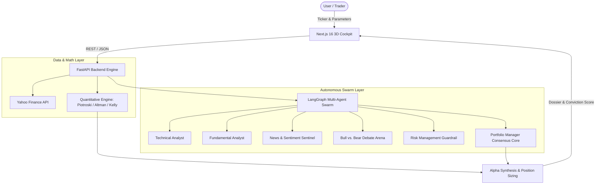

<div align="center">

# ⚡ AlphaSwarm AI
### Autonomous Multi-Agent Quantitative Trading System & 3D Intelligence Cockpit

[](https://opensource.org/licenses/MIT)
[](https://www.python.org/)
[](https://nextjs.org/)
[](https://fastapi.tiangolo.com/)
[](https://threejs.org/)
[](https://ai.google.dev/)
[](https://langchain-ai.github.io/langgraph/)
[](https://github.com/RajatSharma070904)

<br/>

**AlphaSwarm AI** is an institutional-grade algorithmic and quantitative trading intelligence platform. It orchestrates autonomous specialized LLM agents and mathematical quant models to analyze equities across technical, fundamental, macroeconomic, sentiment, and risk dimensions before synthesizing high-conviction trade setups.

</div>

---

## 🌟 Key Features & Innovations

### 1. 🧠 Multi-Agent Swarm Intelligence (LangGraph + Gemini)
- **Market Technical Analyst**: Evaluates OHLCV price action, moving averages (EMA-20, SMA-50, SMA-200), RSI, MACD histograms, and momentum divergence.
- **Fundamental Analyst**: Scrutinizes financial statements, balance sheet liquidity, profit margins, P/E ratios, and growth trajectories.
- **News Sentiment Sentinel**: Monitors real-time financial headlines, macroeconomic developments, and market catalysts.
- **Bull vs. Bear Debate Arena**: Simulates adversarial deliberation between Bullish and Bearish researcher agents to uncover blindspots.
- **Risk Sentinel**: Calculates Value-at-Risk (VaR), drawdown exposure, and max portfolio risk limits.
- **Portfolio Manager (Consensus Core)**: Synthesizes multi-factor inputs into an actionable verdict (`STRONG_BUY`, `BUY`, `HOLD`, `SELL`, `STRONG_SELL`).

### 2. 📐 Mathematical Quantitative Engine (`quant_engine.py`)
- **Piotroski F-Score**: 9-point fundamental health index (Profitability, Leverage, Operating Efficiency).
- **Altman Z-Score**: Evaluates financial distress and bankruptcy probabilities across Safe, Grey, and Distress zones.
- **Half-Kelly Criterion**: Deterministic risk-adjusted position sizing allocating optimal capital per trade.
- **Volatility & Bands**: ATR-14 volatility tracking, Bollinger Bands (%B), and Annualized Historical Volatility.

### 3. 🌐 Institutional 3D Cockpit & Dual Themes
- **Interactive Three.js Neural Swarm**: Real-time 3D orbiting agent nodes visualizing inter-agent telemetry and consensus formation.
- **3D Tactical Conviction Gauge**: Vector-rendered dynamic speedometer displaying conviction percentages and directional bias.
- **Live Ticker Tape Banner**: Streaming marquee for global indices and mega-cap assets.
- **Bull/Bear Market Heatmap & Watchlist**: Live radar screener across Nifty, US tech giants, and momentum movers.
- **Dual Theme System**: Seamless toggle between **Porcelain Light Mode** (Stripe/Linear aesthetic) and **Obsidian Dark Mode**.

---

## 🏗️ System Architecture



---

## 📂 Repository Structure

```
Trading-Agents/
├── cli/                        # Terminal Command-Line Interface
├── frontend/                   # Next.js 16 Web Application
│   ├── src/app/
│   │   ├── components/         # 3D Neural Core, Tactical Gauge, Heatmap, Ticker
│   │   ├── globals.css         # Institutional Dual-Theme Design Tokens
│   │   └── page.tsx            # Main Cockpit UI & Dual-Wing Layout
│   └── package.json
├── tradingagents/              # Python Core Library & Agent Definitions
│   ├── graph/                  # LangGraph Workflow & Agent Graph
│   ├── agents/                 # Specialized Swarm Agents (Bull, Bear, Risk, Tech, Fund)
│   └── quant_engine.py         # Piotroski F-Score, Altman Z, Kelly Sizing, ATR
├── Procfile                    # Cloud Deployment Specification (Render / Railway)
├── Dockerfile                  # Container definition
├── docker-compose.yml          # Multi-container orchestration
├── pyproject.toml              # Python package metadata
├── requirements.txt            # Production dependencies
└── server.py                   # FastAPI REST API Backend
```

---

## ⚡ Quickstart

### Prerequisites
- Python 3.11+
- Node.js 18+ & npm
- [Google Gemini API Key](https://aistudio.google.com/)

### 1. Clone the Repository
```bash
git clone https://github.com/RajatSharma070904/Trading-Agents.git
cd Trading-Agents
```

### 2. Backend Setup
```bash
# Create and activate virtual environment
python -m venv .venv
# Windows:
.\.venv\Scripts\activate
# Linux / macOS:
source .venv/bin/activate

# Install dependencies
pip install -r requirements.txt

# Create .env file with your API key
echo GEMINI_API_KEY="your_gemini_api_key_here" > .env
echo TRADINGAGENTS_LLM_PROVIDER="gemini" >> .env

# Start FastAPI server on port 8000
python server.py
```

### 3. Frontend Setup
```bash
cd frontend
npm install
npm run dev
```
Open **[http://localhost:3000](http://localhost:3000)** in your browser!

---

## 🚀 One-Click Cloud Deployment

### Backend (Render.com)
1. Link your GitHub repo to [Render.com](https://render.com).
2. Create a **New Web Service**.
3. **Build Command**: `pip install -r requirements.txt`
4. **Start Command**: `uvicorn server:app --host 0.0.0.0 --port $PORT`
5. Add Environment Variable: `GEMINI_API_KEY` = `<your-api-key>`

### Frontend (Vercel)
1. Import repository on [Vercel](https://vercel.com).
2. Set **Root Directory** to `frontend`.
3. Add Environment Variable:
   - `NEXT_PUBLIC_API_URL` = `https://<your-render-backend-url>.onrender.com`
4. Click **Deploy**!

---

## 🛡️ License

Distributed under the **MIT License**. See [`LICENSE`](LICENSE) for details.

---

## 👨‍💻 Author

**Rajat Sharma**  
- GitHub: [@RajatSharma070904](https://github.com/RajatSharma070904)  
- Project Repository: [Trading-Agents](https://github.com/RajatSharma070904/Trading-Agents)
